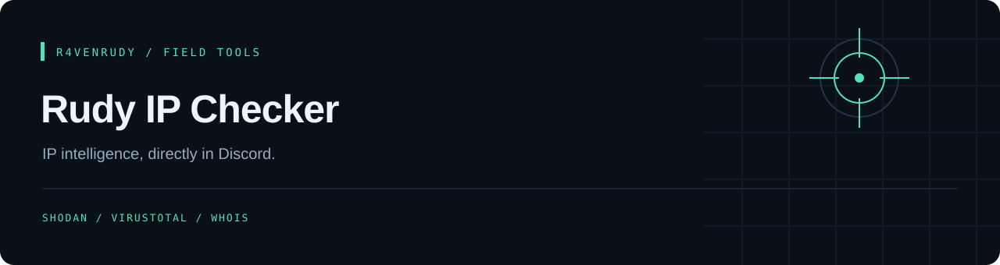

<p align="center"></p>

<p align="center">
  
  
  <a href="LICENSE"></a>
</p>

<p align="center"><strong>IP intelligence, directly in Discord.</strong></p>

<p align="center"><a href="#overview">Overview</a> · <a href="#capabilities">Capabilities</a> · <a href="#quick-start">Quick start</a> · <a href="#implementation-notes">Implementation notes</a></p>

---

## Overview

A Discord slash-command bot that gathers IP observations from Shodan, VirusTotal, RDAP (registry WHOIS) and the Tor Project exit-node list. IPv4 and IPv6 inputs are validated before the integrations run; long output is split into Discord messages.

## Capabilities

| Source | Implemented behavior |
| :--- | :--- |
| Shodan | Organization, ISP, OS, hostnames, known CVEs, then open ports with banners |
| VirusTotal | Retrieves IP-address attributes through the v3 API |
| RDAP | Network name, range, country, owner and abuse contact via rdap.org |
| Tor Project | Checks the exit-address list (IPv4 only, cached 30 minutes) |
| AbuseIPDB | Optional: abuse confidence, report count and usage type when `ABUSEIPDB_KEY` is set |
| Discord | Registers `/ip` and splits long text responses |

## Quick start

Requires Python and a Discord application with a bot token, plus Shodan and VirusTotal API keys. Keep the bundled `raven.png`: startup verifies that it is a readable image.

```bash
git clone https://github.com/r4venrudy/rudy-ip-checker.git
cd rudy-ip-checker
python -m pip install discord.py aiohttp Pillow
```

Create a local `config.json` using your own credentials:

```json
{
  "TOKEN": "YOUR_DISCORD_BOT_TOKEN",
  "SHODAN_KEY": "YOUR_SHODAN_API_KEY",
  "VIRUSTOTAL_API_KEY": "YOUR_VIRUSTOTAL_API_KEY"
}
```

```bash
python main.py
```

Invite the bot with the `bot` and `applications.commands` scopes and permission to view/send messages. Use `/ip 8.8.8.8` in Discord.

## Implementation notes

- The entry point is `main.py`. The legacy dependency file omits Pillow and uses different package names; the explicit install command above matches the imports used by the bot.
- Shodan is queried for existing observations. The code does not initiate a new Shodan scan, capture screenshots or implement a separate geolocation service.
- API access, rate limits, RDAP availability and Discord runtime compatibility need validation in your environment. This documentation review did not run authenticated integrations.
- Replies are public in the channel. Keep credentials local and use the bot only for authorized investigations.

## Example reply

`/ip 8.8.8.8` returns something like:

```text
Organization: Google LLC
Hostnames: dns.google
Port 53/udp - Recursion: enabled
Port 443/tcp - HTTP/1.1 200 OK Server: scaffolding on HTTPServer2
Tor: No
Network: GOGL (NET-8-8-8-0-2)
Range: 8.8.8.0 - 8.8.8.255
Owner: Google LLC
Abuse contact: network-abuse@google.com
VirusTotal: 0 malicious, 0 suspicious, 62 harmless
AS owner: GOOGLE
Country: US
```

Private and reserved addresses (10.x, 192.168.x, loopback) are refused, and a source that fails shows `lookup failed` while the others still answer. Up to 5 lookups run at once.

## Project map

```text
main.py                     Discord command and enrichment integrations
rudy_runtime/config.py      Environment / config.json loading and validation
rudy_runtime/formatting.py  IP validation, banner cleanup, message splitting, VirusTotal summary
tests/                      Unit tests (run during the Docker build)
config.json                 Local API and Discord configuration (YOUR_ placeholders)
requirements.txt            Pinned Python dependencies
raven.png                   Required startup asset
```

Run the tests locally with:

```sh
python -m unittest discover -s tests -v
```

## GitHub package

A non-root container is published to GitHub Packages after build and offline configuration checks. Credentials are supplied at runtime and are excluded from the image.

```sh
cp .env.example .env
# Fill in your own values in .env, keeping that file private.
docker run --rm --env-file .env ghcr.io/r4venrudy/rudy-ip-checker:latest --check-config
docker run --rm --env-file .env ghcr.io/r4venrudy/rudy-ip-checker:latest
```

`--check-config` validates installed dependencies, the bundled asset, and required settings without connecting to Discord. `RUDY_CONFIG` optionally points to a mounted JSON configuration file; environment variables take priority.

Only public project files are packaged. Image tags are `latest` and `sha-<full commit SHA>`. Discord login and external API behavior still require your own account configuration; CI never uses live credentials.


## License

[MIT](LICENSE). Preserve the attribution in the license file.

---

<p align="center">Part of the <a href="https://github.com/r4venrudy">r4venrudy</a> project collection.</p>
